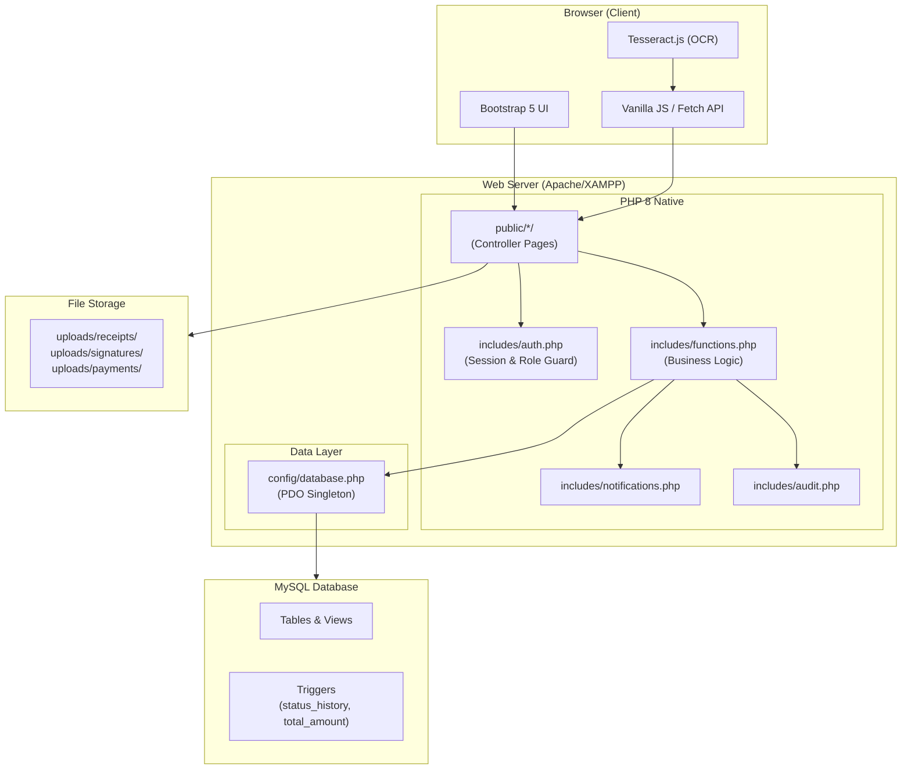
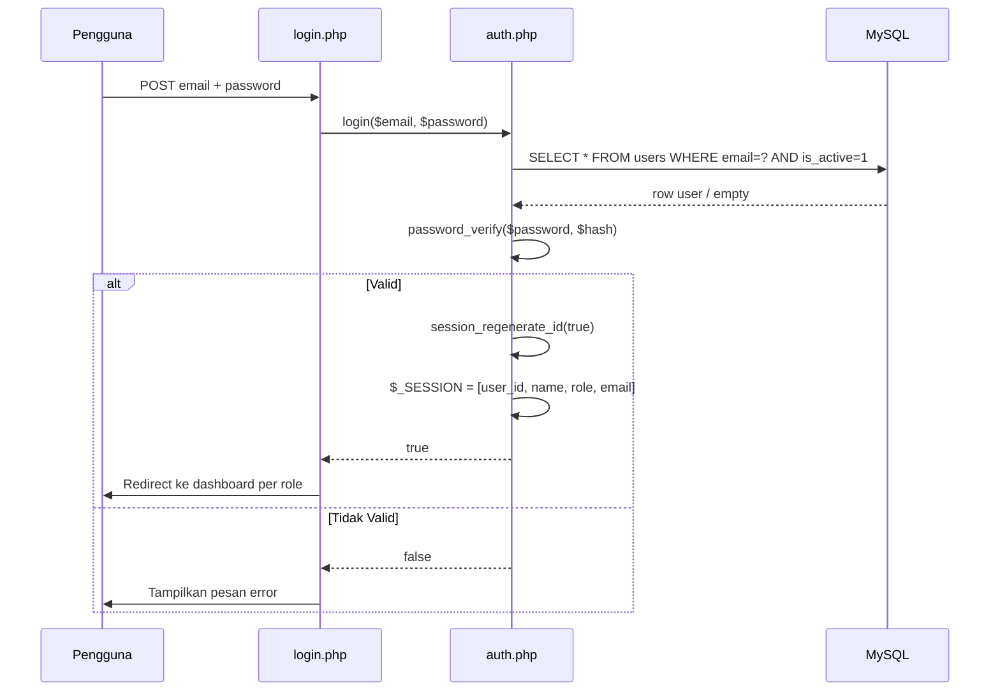
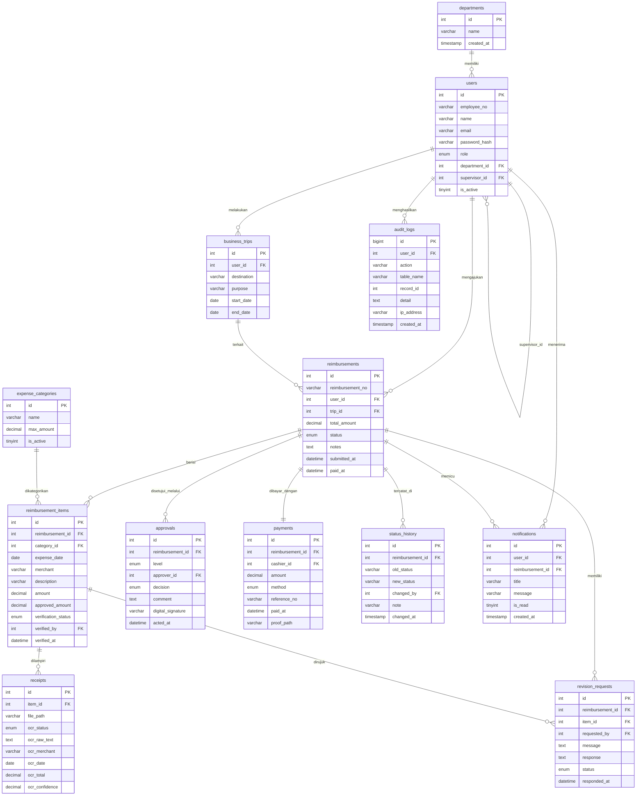
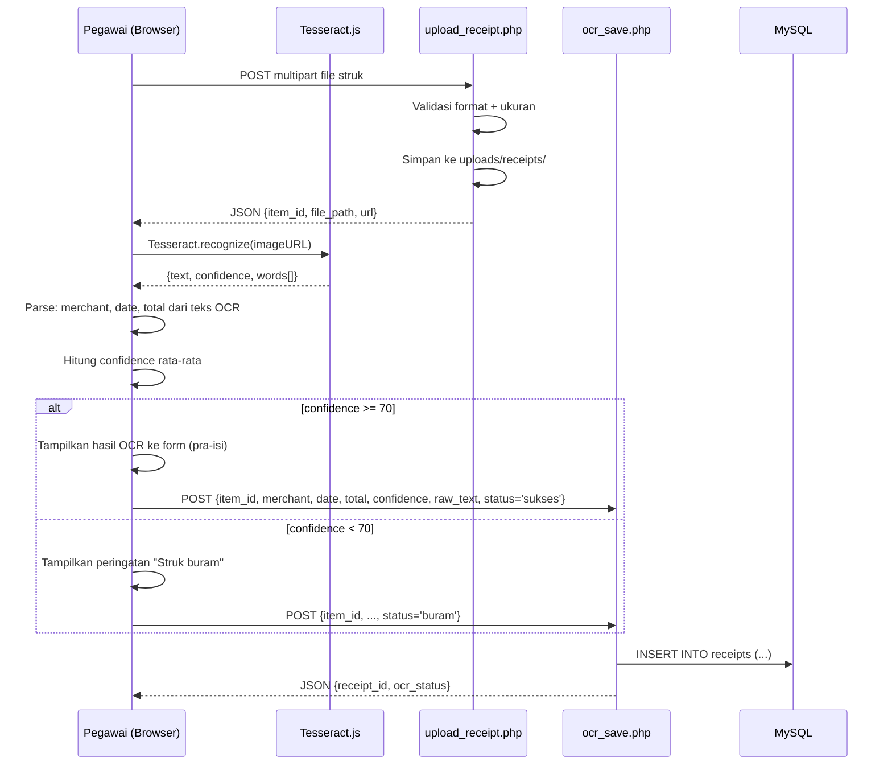
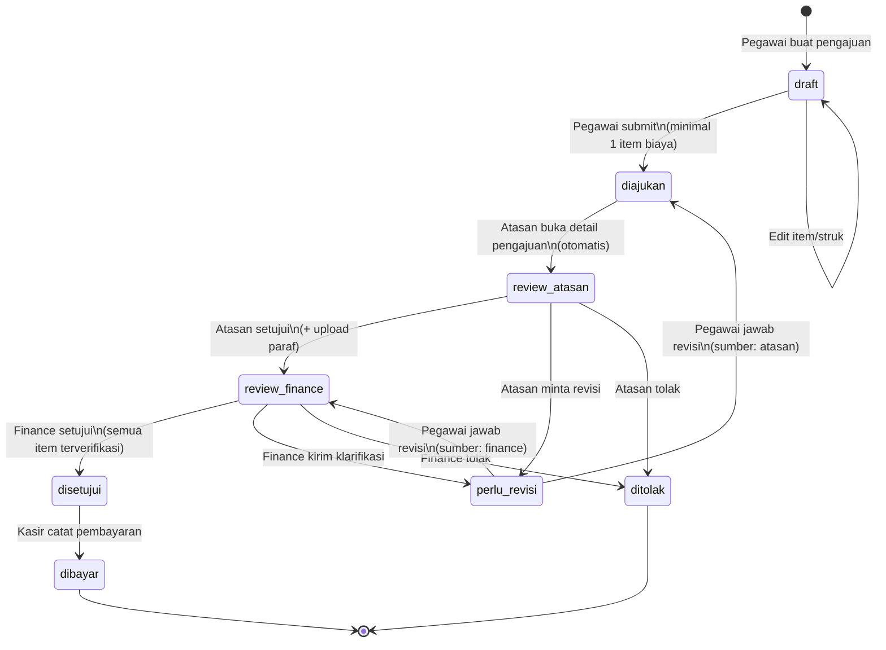

# Design Document — Sistem Reimbursement Perjalanan Dinas

## Daftar Isi

1. [Overview](#overview)
2. [Architecture](#architecture)
3. [Components and Interfaces](#components-and-interfaces)
4. [Data Models](#data-models)
5. [Correctness Properties](#correctness-properties)
6. [Error Handling](#error-handling)
7. [Testing Strategy](#testing-strategy)

---

## Overview

Sistem Reimbursement Perjalanan Dinas adalah aplikasi web berbasis PHP 8 native + MySQL yang mengotomasi seluruh siklus hidup klaim biaya perjalanan dinas — dari pembuatan draft oleh pegawai hingga pencatatan pembayaran oleh kasir.

**Tujuan desain utama:**
- Mengganti alur dokumen kertas dengan alur digital yang dapat dilacak
- Memastikan setiap transisi status tercatat secara otomatis (via database trigger)
- Menyediakan validasi dokumen melalui OCR struk berbasis Tesseract.js (client-side)
- Memberi visibilitas penuh kepada manajemen melalui dashboard dan ekspor laporan

**Pengguna dan tanggung jawab:**

| Role       | Tanggung Jawab Utama                                              |
|------------|-------------------------------------------------------------------|
| pegawai    | Buat draft, tambah item biaya, upload struk, submit, jawab revisi |
| atasan     | Review pengajuan bawahan, setujui/tolak/minta revisi              |
| finance    | Verifikasi item biaya, bandingkan dengan OCR, kirim klarifikasi   |
| kasir      | Catat pembayaran pengajuan yang sudah disetujui                   |
| manajemen  | Pantau dashboard dan ekspor laporan                               |
| admin      | Kelola user, kategori, departemen; lihat semua pengajuan          |

**Alur Status:**

```
draft -> diajukan -> review_atasan -> review_finance -> disetujui -> dibayar
                                            |
                                     perlu_revisi  (bisa kembali ke diajukan atau review_finance)
                                            
Setiap tahap review dapat berakhir: -> ditolak
```

> **Catatan Kritis:** Perubahan kolom `status` pada tabel `reimbursements` akan otomatis dicatat ke `status_history` oleh trigger `trg_reimb_status_au`. Aplikasi **tidak** perlu melakukan INSERT ke `status_history` secara eksplisit.

---

## Architecture

### High-Level Architecture



### Prinsip Arsitektur

- **PHP Native (tanpa framework):** Setiap halaman di `public/` berfungsi sebagai controller-view yang memanggil helper dari `includes/`.
- **PDO Singleton:** Koneksi database dibuat satu kali per request melalui `config/database.php`; seluruh query menggunakan prepared statements.
- **Session PHP Native:** Autentikasi dan otorisasi berbasis `$_SESSION`, dengan pengecekan role dilakukan di awal setiap halaman melalui `require_once` ke `auth.php`.
- **Trigger-driven Status History:** Tidak ada kode aplikasi yang menulis ke `status_history` — sepenuhnya ditangani trigger MySQL.
- **OCR Client-side:** Tesseract.js berjalan di browser; hasil dikirims ke server via AJAX satu kali setelah pemrosesan selesai. Ini menghindari beban server untuk processing gambar.

---

## Components and Interfaces

### Struktur Direktori

```
reimbursement/
├── config/
│   └── database.php          ← Koneksi PDO singleton; return $pdo
├── includes/
│   ├── auth.php               ← login(), logout(), requireAuth(), requireRole(), isLoggedIn()
│   ├── functions.php          ← Helper umum: generateReimbNo(), formatRupiah(), getStatusLabel()
│   ├── notifications.php      ← createNotification(), getUnreadCount(), markAsRead()
│   ├── audit.php              ← logAudit($userId, $action, $table, $recordId, $detail)
│   └── layout/
│       ├── header.php         ← <!DOCTYPE>, <head>, CSS imports
│       ├── navbar.php         ← Navbar responsif + badge notifikasi
│       └── footer.php         ← Tutup tag, JS imports
├── public/
│   ├── index.php              ← Redirect ke login
│   ├── login.php              ← Form login, proses POST
│   ├── logout.php             ← Hancurkan sesi, redirect login
│   ├── dashboard.php          ← Redirect per role ke halaman utama masing-masing
│   ├── pegawai/
│   │   ├── index.php          ← Daftar pengajuan milik pegawai, diurutkan terbaru
│   │   ├── create.php         ← Form buat pengajuan + trip + item biaya
│   │   ├── detail.php         ← Detail pengajuan + timeline status + item + struk
│   │   └── revisi.php         ← Form jawab revision_request
│   ├── atasan/
│   │   ├── index.php          ← Daftar pengajuan bawahan langsung berstatus "diajukan" dan "review_atasan"
│   │   └── review.php         ← Detail pengajuan; aksi: setujui (upload paraf), tolak, minta revisi
│   ├── finance/
│   │   ├── index.php          ← Daftar pengajuan berstatus "review_finance"
│   │   └── verifikasi.php     ← Verifikasi per item; kirim klarifikasi; setujui/tolak keseluruhan
│   ├── kasir/
│   │   ├── index.php          ← Daftar pengajuan berstatus "disetujui"
│   │   └── bayar.php          ← Form catat pembayaran; upload bukti; simpan
│   ├── manajemen/
│   │   ├── dashboard.php      ← Ringkasan KPI + breakdown status bulan berjalan
│   │   └── laporan.php        ← Filter periode/departemen/kategori; tabel laporan; ekspor
│   └── admin/
│       ├── users.php          ← CRUD user; reset password; toggle aktif/nonaktif
│       ├── categories.php     ← CRUD kategori biaya; toggle aktif
│       ├── departments.php    ← CRUD departemen
│       ├── reimbursements.php ← Semua pengajuan lintas departemen, filter status/dept/pegawai/tanggal (read + lihat detail)
│       └── audit_log.php      ← Tampilan audit log read-only, filter user/aksi/tanggal/tabel
└── uploads/
    ├── receipts/              ← Foto struk item biaya
    ├── signatures/            ← Paraf digital atasan
    └── payments/              ← Bukti pembayaran kasir
```

### Komponen Inti

#### 1. `config/database.php` — PDO Singleton

```php
// config/database.php — koneksi PDO + konstanta global
define('BASE_URL', '/reimbursement/public');  // Ubah sesuai lokasi instalasi

// Mengembalikan PDO yang sama untuk seluruh siklus request
function getDB(): PDO {
    static $pdo = null;
    if ($pdo === null) {
        $pdo = new PDO('mysql:host=localhost;dbname=reimbursement_db;charset=utf8mb4',
                       'root', '', [PDO::ATTR_ERRMODE => PDO::ERRMODE_EXCEPTION,
                                    PDO::ATTR_DEFAULT_FETCH_MODE => PDO::FETCH_ASSOC]);
    }
    return $pdo;
}
```

**Aturan penggunaan `BASE_URL`:**
- Semua `header('Location: ...')` **HARUS** memakai `BASE_URL`, contoh: `header('Location: ' . BASE_URL . '/login.php');`
- Semua `<a href="...">` dan `<form action="...">` **HARUS** memakai `<?= BASE_URL ?>/path`
- Semua URL `fetch()` di JavaScript **HARUS** memakai variabel JS `const BASE_URL = '<?= BASE_URL ?>';` yang di-inject di `navbar.php`

#### 2. `includes/auth.php` — Autentikasi & Otorisasi

**Fungsi-fungsi utama:**

| Fungsi | Deskripsi |
|--------|-----------|
| `login(string $email, string $password): bool` | Ambil user by email, verifikasi dengan `password_verify()`, buat sesi |
| `logout(): void` | `session_unset()`, `session_destroy()`, redirect ke login |
| `requireAuth(): void` | Cek `$_SESSION['user_id']`; redirect login jika tidak ada |
| `requireRole(array $roles): void` | Cek `$_SESSION['role']`; tampilkan 403 jika tidak sesuai |
| `getCurrentUser(): array` | Kembalikan array data user dari sesi |
| `isSessionExpired(): bool` | Cek `$_SESSION['last_activity']`; invalidasi jika > 1800 detik |

**Alur Login:**



**Pengecekan Role di Setiap Halaman:**

```php
// Baris pertama setiap halaman yang memerlukan autentikasi
require_once __DIR__ . '/../../includes/auth.php';
requireAuth();
requireRole(['pegawai']); // atau role yang sesuai
```

**Session Timeout (30 menit):**

```php
// Di requireAuth()
if (isset($_SESSION['last_activity']) && 
    (time() - $_SESSION['last_activity'] > 1800)) {
    session_unset();
    session_destroy();
    header('Location: ' . BASE_URL . '/login.php?timeout=1');
    exit;
}
$_SESSION['last_activity'] = time();
```

#### 3. `includes/functions.php` — Helper Bisnis

| Fungsi | Deskripsi |
|--------|-----------|
| `generateReimbNo(): string` | Format `RMB-{YYYY}-{000001}` berdasarkan COUNT tahun ini |
| `formatRupiah(float $n): string` | `Rp 1.234.000` |
| `getStatusLabel(string $status): string` | Label + class badge Bootstrap per status |
| `getStatusHistory(int $reimbId): array` | Ambil riwayat dari `status_history` JOIN `users` |
| `canEdit(array $reimbursement): bool` | true jika status draft atau perlu_revisi |
| `getSubordinates(int $supervisorId): array` | Ambil user dengan `supervisor_id = $supervisorId` |

#### 4. `includes/notifications.php`

| Fungsi | Deskripsi |
|--------|-----------|
| `createNotification(int $userId, int $reimbId, string $title, string $msg): void` | INSERT ke `notifications` |
| `getUnreadCount(int $userId): int` | COUNT `is_read=0` |
| `getNotifications(int $userId, int $limit=10): array` | SELECT 10 notif terbaru |
| `markAsRead(int $notifId, int $userId): void` | UPDATE `is_read=1` dengan validasi kepemilikan |
| `markAllAsRead(int $userId): void` | UPDATE semua `is_read=0` milik user |

#### 5. `includes/audit.php`

```php
function logAudit(
    int $userId,
    string $action,       // 'LOGIN', 'CREATE_REIMBURSEMENT', 'UPDATE_STATUS', dll
    string $tableName,
    int $recordId,
    array $detail = []    // ['before' => [...], 'after' => [...]]
): void {
    // JSON encode $detail, INSERT ke audit_logs
}
```

### AJAX Endpoints

Endpoint async diimplementasikan sebagai PHP page terpisah yang mengembalikan JSON:

| Endpoint | Method | Role | Deskripsi |
|----------|--------|------|-----------|
| `BASE_URL . '/api/ocr_save.php'` | POST | pegawai | Simpan hasil OCR dari Tesseract.js ke tabel `receipts` |
| `BASE_URL . '/api/item_verify.php'` | POST | finance | Update `verification_status` satu item biaya |
| `BASE_URL . '/api/notifications.php'` | GET | semua | Ambil notifikasi + unread count (polling setiap 30 detik) |
| `BASE_URL . '/api/mark_notif.php'` | POST | semua | Tandai satu/semua notifikasi sebagai dibaca |
| `BASE_URL . '/api/upload_receipt.php'` | POST | pegawai | Upload foto struk, kembalikan path untuk OCR |
| `BASE_URL . '/api/delete_item.php'` | POST | pegawai | Hapus item biaya (hanya status draft) |

Semua endpoint memeriksa sesi terlebih dahulu dan mengembalikan `{"error": "Unauthorized"}` dengan HTTP 401 jika tidak terautentikasi.

---

## Data Models

### Diagram Relasi Entitas



### Kolom Tambahan (Sudah Ada di Database)

Kolom-kolom berikut telah ditambahkan langsung ke database dan **tidak memerlukan ALTER TABLE**:

- `reimbursement_items.verification_status` — ENUM('belum','diverifikasi','ditolak') DEFAULT 'belum'
- `reimbursement_items.verified_by` — INT FK ke users(id), diisi saat finance verifikasi
- `reimbursement_items.verified_at` — DATETIME, diisi saat finance verifikasi
- `payments.proof_path` — VARCHAR(255) NULL, path file bukti pembayaran yang diupload kasir

### Deskripsi Tabel Utama

**`reimbursements` (Header Pengajuan)**
Tabel sentral sistem. Kolom `status` menggerakkan seluruh alur kerja. Trigger `trg_reimb_status_au` secara otomatis mengisi `status_history` setiap kali `status` berubah. Kolom `total_amount` diperbarui otomatis oleh trigger `trg_item_ai/au/ad` berdasarkan jumlah semua `reimbursement_items`.

**`reimbursement_items` (Item Biaya)**
Setiap item biaya mewakili satu transaksi dalam satu pengajuan. Finance memperbarui kolom `verification_status`, `verified_by`, dan `verified_at` per item. Kolom `approved_amount` diisi finance jika nominal yang disetujui berbeda dari `amount` yang diinput pegawai.

**`receipts` (Struk & Hasil OCR)**
Satu item biaya dapat memiliki lebih dari satu struk (misalnya struk asli + foto ulang). Kolom `ocr_confidence` bernilai 0–100; nilai di bawah 70 menyebabkan `ocr_status = 'buram'`. Kolom `ocr_raw_text` menyimpan hasil mentah OCR untuk referensi audit.

**`approvals` (Rekam Keputusan Review)**
Setiap tahap review (atasan dan finance) menghasilkan satu record approval. Kolom `digital_signature` menyimpan path file paraf yang diunggah atasan. Level `'atasan'` dan `'finance'` merepresentasikan dua lapisan persetujuan.

**`revision_requests` (Permintaan Revisi)**
Digunakan oleh atasan dan finance untuk meminta perbaikan dari pegawai. Kolom `item_id` bersifat opsional — jika diisi, revisi ditujukan untuk item biaya tertentu; jika NULL, revisi untuk keseluruhan pengajuan. Pegawai mengisi kolom `response` dan mengubah `status` menjadi `'dijawab'`.

### Views yang Tersedia

| View | Digunakan Oleh | Isi |
|------|----------------|-----|
| `v_laporan_reimbursement` | manajemen/laporan | JOIN lengkap reimbursements + users + departments + trips, termasuk `lama_proses_hari` |
| `v_rekap_bulanan` | manajemen/dashboard | Agregasi per bulan: jumlah, total, total dibayar, rata-rata hari proses |
| `v_rekap_kategori` | manajemen/laporan | Total dan jumlah item per kategori biaya |

---

## Correctness Properties

*A property is a characteristic or behavior that should hold true across all valid executions of a system — essentially, a formal statement about what the system should do. Properties serve as the bridge between human-readable specifications and machine-verifiable correctness guarantees.*

### Property 1: Status Transition Validity (Validitas Transisi Status)

*For any* pengajuan reimbursement dalam status apapun, setiap perubahan status yang dilakukan fungsi `updateReimbursementStatus()` hanya boleh mengikuti transisi yang terdaftar dalam peta `VALID_TRANSITIONS`:
- `draft` → `diajukan`
- `diajukan` → `review_atasan`
- `review_atasan` → `review_finance` | `perlu_revisi` | `ditolak`
- `review_finance` → `disetujui` | `perlu_revisi` | `ditolak`
- `perlu_revisi` → `diajukan` | `review_finance`
- `disetujui` → `dibayar`

Setiap upaya transisi ke status lain yang tidak terdaftar HARUS melempar exception atau mengembalikan false tanpa melakukan perubahan data.

**Validates: Requirements 2.3, 2.7, 4.4, 4.5, 4.6, 5.5, 5.6, 6.2**

---

### Property 2: Total Amount Consistency (Konsistensi Total Nominal)

*For any* pengajuan dengan sejumlah item biaya, nilai `total_amount` di tabel `reimbursements` HARUS selalu sama dengan `SUM(amount)` dari seluruh `reimbursement_items` yang terkait, untuk setiap keadaan setelah operasi INSERT, UPDATE, atau DELETE pada item biaya.

Invariant ini dijamin oleh trigger database (`trg_item_ai/au/ad`), namun fungsi `getReimbursement()` HARUS memverifikasi konsistensi ini sebelum menampilkan total ke pengguna.

**Validates: Requirements 2.2**

---

### Property 3: Role-Based Access Isolation (Isolasi Akses Berbasis Role)

*For any* kombinasi (pengguna aktif dengan role R, halaman yang bukan milik role R), fungsi `requireRole()` HARUS mengembalikan HTTP 403 tanpa memproses request lebih lanjut. Selain itu, untuk semua pengguna tanpa sesi aktif yang mencoba mengakses halaman apapun yang dilindungi, fungsi `requireAuth()` HARUS mengarahkan ke halaman login.

**Validates: Requirements 1.3, 1.5, 1.6, 1.7**

---

### Property 4: OCR Confidence Threshold (Ambang Batas Kepercayaan OCR)

*For any* nilai `confidence` dalam rentang 0–100 yang dihasilkan Tesseract.js, fungsi `determineOcrStatus(confidence)` HARUS mengembalikan `'buram'` jika dan hanya jika `confidence < 70`, dan mengembalikan `'sukses'` jika `confidence >= 70`. Record yang disimpan ke tabel `receipts` HARUS mencerminkan status ini secara konsisten.

**Validates: Requirements 3.3**

---

### Property 5: Subordinate Visibility (Visibilitas Eksklusif Bawahan Langsung)

*For any* atasan yang memanggil fungsi `getSubordinateReimbursements($supervisorId)`, seluruh pengajuan yang dikembalikan HARUS berasal dari pegawai dengan `supervisor_id = $supervisorId`. Pengajuan dari pegawai yang bukan bawahan langsung, termasuk pengajuan dari atasan sendiri, tidak boleh muncul dalam hasil.

**Validates: Requirements 4.1**

---

### Property 6: Finance Verification Completeness Gate (Gerbang Kelengkapan Verifikasi Finance)

*For any* pengajuan yang diperiksa oleh fungsi `canFinanceApprove($reimbId)`, fungsi tersebut HARUS mengembalikan `true` jika dan hanya jika SEMUA item biaya dalam pengajuan tersebut memiliki `verification_status` bernilai `'diverifikasi'` atau `'ditolak'` (tidak ada satu item pun yang berstatus `'belum'`). Jika setidaknya satu item masih berstatus `'belum'`, fungsi HARUS mengembalikan `false` dan sistem HARUS menolak persetujuan.

**Validates: Requirements 5.7**

---

### Property 7: Payment Non-Zero Amount (Nominal Pembayaran Positif)

*For any* nilai yang disubmit sebagai nominal pembayaran (termasuk nol, negatif, null, dan string kosong), fungsi `isValidPaymentAmount($amount)` HARUS mengembalikan `true` jika dan hanya jika nilai tersebut merupakan angka positif lebih dari nol. Fungsi `savePayment()` HARUS menolak eksekusi INSERT jika validasi ini gagal.

**Validates: Requirements 6.5**

---

### Property 8: Notification Delivery on Status Change (Keharusan Notifikasi saat Transisi Status)

*For any* pemanggilan fungsi `updateReimbursementStatus()` yang berhasil (tidak menghasilkan exception), fungsi `createNotification()` HARUS dipanggil setidaknya satu kali untuk penerima yang relevan sesuai alur status. Tidak ada perubahan status yang boleh selesai dieksekusi tanpa menghasilkan minimal satu record notifikasi di tabel `notifications`.

**Validates: Requirements 8.1**

---

### Property 9: Audit Log Immutability (Imutabilitas Audit Log)

*For any* operasi yang dapat dilakukan melalui antarmuka pengguna sistem (termasuk admin), tidak boleh ada fungsi yang mengeksekusi pernyataan `DELETE` atau `UPDATE` pada tabel `audit_logs`. Setiap pengujian yang mensimulasikan berbagai aksi berurutan HARUS menghasilkan `COUNT(audit_logs)` yang monoton bertambah dan tidak pernah berkurang.

**Validates: Requirements 8.6**

---

### Property 10: Revision Source Routing (Routing Status berdasarkan Sumber Revisi)

*For any* pengajuan berstatus `perlu_revisi` ketika pegawai memanggil `answerRevision($reimbId, $response)`, status baru yang diset HARUS ditentukan secara eksklusif berdasarkan `role` dari pengguna yang membuat `revision_request` (`requested_by`): jika role-nya `'atasan'` maka status baru = `'diajukan'`; jika role-nya `'finance'` maka status baru = `'review_finance'`. Tidak ada kemungkinan status lain yang boleh dihasilkan dari operasi ini.

**Validates: Requirements 2.7**

---

### Property 11: OCR Data Round-Trip (Round-Trip Penyimpanan Data OCR)

*For any* set hasil OCR yang valid (merchant, tanggal, total, confidence, raw_text), setelah disimpan ke tabel `receipts` melalui endpoint `ocr_save.php` dan kemudian dibaca kembali dengan `getReceiptOcrData($receiptId)`, seluruh field yang disimpan HARUS menghasilkan nilai yang identik dengan data yang dikirimkan.

**Validates: Requirements 3.2**

---

### Property 12: File Format Validation (Validasi Format File yang Konsisten)

*For any* nama file atau MIME type yang diperiksa oleh fungsi `isValidUploadFile($filePath, $mimeType)`, fungsi HARUS mengembalikan `true` jika dan hanya jika ekstensi file adalah salah satu dari `jpg`, `jpeg`, `png`, `pdf` DAN MIME type sesuai dengan ekstensi tersebut (diverifikasi via `finfo`, bukan `$_FILES['type']`). Semua ekstensi lain HARUS selalu menghasilkan `false` tanpa pengecualian.

**Validates: Requirements 3.6, 6.4**

---

### Property 13: Password Always Hashed (Password Selalu Di-hash)

*For any* string password yang diproses oleh fungsi `createUser()` atau `resetPassword()`, nilai yang tersimpan di kolom `password_hash` HARUS selalu berupa hash bcrypt yang valid (`password_verify($plain, $stored) === true`) dan nilai `$stored` HARUS tidak pernah identik dengan `$plain` dalam bentuk apapun.

**Validates: Requirements 9.1, 9.3**

---

### Property 14: User Deactivation Guard (Perlindungan Deaktivasi User Aktif)

*For any* user yang diperiksa oleh fungsi `canDeactivateUser($userId)`, fungsi HARUS mengembalikan `false` jika pengguna tersebut memiliki setidaknya satu pengajuan dengan status selain `'dibayar'` atau `'ditolak'`. Fungsi HARUS mengembalikan `true` hanya jika tidak ada pengajuan aktif yang terkait.

**Validates: Requirements 9.7**

---

### Property 15: Unread Count Reset After Mark All Read (Reset Jumlah Notif Belum Dibaca)

*For any* pengguna dengan jumlah notifikasi belum dibaca berapa pun (termasuk nol), setelah pemanggilan `markAllAsRead($userId)` selesai, pemanggilan `getUnreadCount($userId)` HARUS selalu mengembalikan `0`. Ini adalah properti idempoten: memanggil `markAllAsRead()` dua kali berturut-turut HARUS menghasilkan efek yang sama dengan memanggil sekali.

**Validates: Requirements 8.7**

---

## Error Handling

### Kategori Error dan Respons

| Kategori | Contoh | Respons Sistem |
|----------|--------|----------------|
| Autentikasi gagal | Email/password salah | Flash message merah, tidak buat sesi |
| Akses tidak sah | Role tidak sesuai | HTTP 403, halaman error.php |
| Validasi input | Submit tanpa item biaya | Flash message inline, tetap di halaman |
| File upload invalid | Format bukan JPEG/PNG/PDF | Tolak upload, tampilkan pesan format |
| OCR gagal | Tesseract error / timeout | Log error, izinkan simpan tanpa OCR data |
| Database error | PDO Exception | Log error server, tampilkan pesan generik ke user |
| Transaksi gagal | Nominal bayar = 0 | Validasi server-side, kembalikan form |

### Strategi Flash Message

Flash message disimpan di `$_SESSION['flash']` dan di-render oleh `navbar.php` sekali kemudian dihapus:

```php
// Menyimpan
$_SESSION['flash'] = ['type' => 'danger', 'message' => 'Pengajuan harus memiliki minimal satu item biaya'];

// Menampilkan (di navbar.php)
if (isset($_SESSION['flash'])) {
    echo '<div class="alert alert-' . $_SESSION['flash']['type'] . '">' 
         . htmlspecialchars($_SESSION['flash']['message']) . '</div>';
    unset($_SESSION['flash']);
}
```

### Error Handling Upload File

```
1. Periksa $_FILES['file']['error'] != UPLOAD_ERR_OK
2. Validasi MIME type via finfo_file() — JANGAN percaya $_FILES['type']
3. Validasi ekstensi file: hanya jpg, jpeg, png, pdf
4. Batasi ukuran: maksimum 5 MB
5. Generate nama file unik: uniqid() + ekstensi
6. Simpan ke uploads/{subdir}/{filename}
7. Simpan path relatif ke database
```

### CSRF Protection

Setiap form POST dilindungi CSRF token:

```php
// Generate (di form)
$_SESSION['csrf_token'] = bin2hex(random_bytes(32));

// Validasi (di handler)
if (!hash_equals($_SESSION['csrf_token'], $_POST['csrf_token'])) {
    http_response_code(403);
    die('Token tidak valid');
}
```

---

## Testing Strategy

> **Catatan Prioritas:** Seluruh unit test dan property-based test yang didokumentasikan di bagian ini bersifat **opsional**. Pada file `tasks.md`, task-task pengujian akan ditandai dengan tanda bintang (*) sehingga dapat dilewati tanpa menghambat implementasi fitur utama. Implementasikan pengujian hanya jika waktu dan sumber daya memungkinkan.

### Pendekatan Pengujian Ganda

Sistem menggunakan kombinasi:
1. **Unit test (contoh spesifik):** Untuk logika bisnis di `includes/` yang dapat diuji secara terisolasi
2. **Property-based test (universal):** Untuk memverifikasi properti yang harus berlaku di semua input

Kedua pendekatan ini **komplementer dan keduanya diperlukan** untuk cakupan komprehensif. Unit test menangkap bug konkret dengan contoh spesifik, property test memverifikasi kebenaran umum di seluruh ruang input.

### Alat Pengujian

- **Framework:** PHPUnit 11 (PHP 8)
- **Property-based testing:** [PhpQuickCheck](https://github.com/steos/php-quickcheck) — library PBT untuk PHP
- **Coverage:** XDebug + PHPUnit `--coverage-html`
- **Database test:** MySQL in-memory atau SQLite dengan schema yang sama, transaksi di-rollback setelah setiap test

### Unit Test (Contoh Spesifik)

Fokus unit test pada fungsi helper dan logika validasi di `includes/`:

| Komponen | Skenario Test |
|----------|---------------|
| `auth.php::login()` | Email valid + password benar → sesi dibuat; email tidak ada → return false |
| `auth.php::isSessionExpired()` | `last_activity` > 1800 detik → return true; <= 1800 → return false |
| `functions.php::generateReimbNo()` | Format `RMB-YYYY-000001` dengan padding 6 digit, increment berdasarkan tahun |
| `functions.php::canEdit()` | Status draft → true; status review_atasan → false |
| Upload validation | File JPEG 2MB → diterima; file EXE → ditolak; file 6MB → ditolak |
| OCR confidence check | confidence 65 → status `buram`; confidence 85 → status `sukses` |
| Revision routing | revision dari atasan → status `diajukan`; dari finance → `review_finance` |
| Password hashing | `password_verify()` berhasil untuk plain text yang benar; gagal untuk yang salah |

**Catatan:** Unit test tidak menguji banyak input — cukup 1-3 contoh per case. Property test yang menangani variasi luas.

---

### Property-Based Test

Setiap property test dijalankan minimal **100 iterasi** dengan data yang di-generate secara acak. Setiap test diberi tag komentar yang merujuk ke property dalam dokumen desain.

**Format tag:** `// Feature: reimbursement-perjalanan-dinas, Property {N}: {judul_property}`

**Konfigurasi minimal:**
```php
// Di phpunit.xml atau bootstrap test
define('PBT_ITERATIONS', 100);
```

---

#### Property 1 — Status Transition Validity

```php
// Feature: reimbursement-perjalanan-dinas, Property 1: Status Transition Validity
public function test_status_transitions_only_follow_valid_paths(): void {
    $validTransitions = [
        'draft'          => ['diajukan'],
        'diajukan'       => ['review_atasan'],
        'review_atasan'  => ['review_finance', 'perlu_revisi', 'ditolak'],
        'review_finance' => ['disetujui', 'perlu_revisi', 'ditolak'],
        'perlu_revisi'   => ['diajukan', 'review_finance'],
        'disetujui'      => ['dibayar'],
    ];
    
    $allStatuses = array_keys($validTransitions);
    
    for ($i = 0; $i < PBT_ITERATIONS; $i++) {
        $currentStatus = $allStatuses[array_rand($allStatuses)];
        $targetStatus = $allStatuses[array_rand($allStatuses)];
        
        $expected = in_array($targetStatus, $validTransitions[$currentStatus] ?? []);
        $actual = isValidTransition($currentStatus, $targetStatus);
        
        $this->assertEquals($expected, $actual,
            "Transisi {$currentStatus} -> {$targetStatus} seharusnya " . ($expected ? 'valid' : 'invalid'));
    }
}
```

#### Property 2 — Total Amount Consistency

```php
// Feature: reimbursement-perjalanan-dinas, Property 2: Total Amount Consistency
public function test_total_amount_equals_sum_of_items(): void {
    for ($i = 0; $i < PBT_ITERATIONS; $i++) {
        // Generate pengajuan dengan 1-10 item acak
        $reimbId = $this->createTestReimbursement();
        $numItems = rand(1, 10);
        $expectedSum = 0;
        
        for ($j = 0; $j < $numItems; $j++) {
            $amount = rand(1000, 1000000) / 100; // Rp 10 - Rp 10.000
            $this->createTestItem($reimbId, $amount);
            $expectedSum += $amount;
        }
        
        $reimbursement = getReimbursement($reimbId);
        $this->assertEquals($expectedSum, $reimbursement['total_amount'], 
            "Total amount tidak konsisten dengan SUM item", 0.01);
    }
}
```

#### Property 3 — Role-Based Access Isolation

```php
// Feature: reimbursement-perjalanan-dinas, Property 3: Role-Based Access Isolation
public function test_role_access_always_enforced(): void {
    $rolePages = [
        'pegawai'   => ['pegawai/index.php', 'pegawai/create.php', 'pegawai/detail.php'],
        'atasan'    => ['atasan/index.php', 'atasan/review.php'],
        'finance'   => ['finance/index.php', 'finance/verifikasi.php'],
        'kasir'     => ['kasir/index.php', 'kasir/bayar.php'],
        'manajemen' => ['manajemen/dashboard.php', 'manajemen/laporan.php'],
        'admin'     => ['admin/users.php', 'admin/categories.php'],
    ];
    
    for ($i = 0; $i < PBT_ITERATIONS; $i++) {
        // Pick role acak dan halaman dari role lain
        $userRole = array_rand($rolePages);
        $otherRoles = array_keys(array_diff_key($rolePages, [$userRole => null]));
        $randomOtherRole = $otherRoles[array_rand($otherRoles)];
        $forbiddenPage = $rolePages[$randomOtherRole][array_rand($rolePages[$randomOtherRole])];
        
        // Simulasi requireRole() dengan mock session
        $_SESSION['role'] = $userRole;
        
        $this->expectException(AccessDeniedException::class);
        // Atau: $this->assertEquals(403, checkPageAccess($forbiddenPage));
    }
}
```

#### Property 4 — OCR Confidence Threshold

```php
// Feature: reimbursement-perjalanan-dinas, Property 4: OCR Confidence Threshold
public function test_ocr_status_buram_when_confidence_below_70(): void {
    for ($i = 0; $i < PBT_ITERATIONS; $i++) {
        $confidence = rand(0, 10000) / 100; // 0.00 - 100.00
        $status = determineOcrStatus($confidence);
        
        if ($confidence < 70) {
            $this->assertEquals('buram', $status, "Confidence {$confidence}% harus 'buram'");
        } else {
            $this->assertEquals('sukses', $status, "Confidence {$confidence}% harus 'sukses'");
        }
    }
}
```

#### Property 5 — Subordinate Visibility

```php
// Feature: reimbursement-perjalanan-dinas, Property 5: Subordinate Visibility
public function test_supervisor_only_sees_direct_subordinates(): void {
    for ($i = 0; $i < PBT_ITERATIONS; $i++) {
        // Buat struktur org: 1 supervisor + 2-5 bawahan + 2-3 non-bawahan
        $supervisorId = $this->createTestUser('atasan');
        $numSubs = rand(2, 5);
        $subordinateIds = [];
        for ($j = 0; $j < $numSubs; $j++) {
            $subordinateIds[] = $this->createTestUser('pegawai', $supervisorId);
        }
        
        $numOthers = rand(2, 3);
        for ($k = 0; $k < $numOthers; $k++) {
            $this->createTestUser('pegawai', null); // Tanpa supervisor atau supervisor lain
        }
        
        // Buat pengajuan dari bawahan dan non-bawahan
        foreach ($subordinateIds as $subId) {
            $this->createTestReimbursement($subId, 'diajukan');
        }
        
        $visibleReimbs = getSubordinateReimbursements($supervisorId);
        
        foreach ($visibleReimbs as $reimb) {
            $this->assertContains($reimb['user_id'], $subordinateIds, 
                "Pengajuan dari non-bawahan tidak boleh muncul");
        }
    }
}
```

#### Property 6 — Finance Verification Completeness Gate

```php
// Feature: reimbursement-perjalanan-dinas, Property 6: Finance Verification Completeness Gate
public function test_finance_cannot_approve_until_all_items_verified(): void {
    for ($i = 0; $i < PBT_ITERATIONS; $i++) {
        $reimbId = $this->createTestReimbursement();
        $numItems = rand(2, 10);
        $numVerified = rand(0, $numItems); // Beberapa verified, sebagian belum
        
        for ($j = 0; $j < $numItems; $j++) {
            $itemId = $this->createTestItem($reimbId);
            if ($j < $numVerified) {
                $this->verifyItem($itemId); // verification_status = 'diverifikasi'
            }
            // Sisanya tetap 'belum'
        }
        
        $canApprove = canFinanceApprove($reimbId);
        
        if ($numVerified === $numItems) {
            $this->assertTrue($canApprove, "Semua item verified, harus bisa approve");
        } else {
            $this->assertFalse($canApprove, "Masih ada item belum verified, tidak boleh approve");
        }
    }
}
```

#### Property 7 — Payment Non-Zero Amount

```php
// Feature: reimbursement-perjalanan-dinas, Property 7: Payment Non-Zero Amount
public function test_payment_amount_must_be_positive(): void {
    for ($i = 0; $i < PBT_ITERATIONS; $i++) {
        // Generate berbagai nilai termasuk negatif, nol, positif
        $testValues = [
            rand(-100000, -1) / 100,  // negatif
            0,
            0.00,
            rand(1, 1000000) / 100,   // positif
            null,
            '',
        ];
        
        $amount = $testValues[array_rand($testValues)];
        $valid = isValidPaymentAmount($amount);
        
        if (is_numeric($amount) && $amount > 0) {
            $this->assertTrue($valid, "Nominal {$amount} valid");
        } else {
            $this->assertFalse($valid, "Nominal {$amount} harus ditolak");
        }
    }
}
```

#### Property 8 — Notification Delivery on Status Change

```php
// Feature: reimbursement-perjalanan-dinas, Property 8: Notification Delivery on Status Change
public function test_every_status_change_creates_notification(): void {
    $validTransitions = [
        'draft' => 'diajukan',
        'diajukan' => 'review_atasan',
        'review_atasan' => 'review_finance',
        // ... dst
    ];
    
    for ($i = 0; $i < PBT_ITERATIONS; $i++) {
        $transitionKey = array_rand($validTransitions);
        $oldStatus = $transitionKey;
        $newStatus = $validTransitions[$transitionKey];
        
        $reimbId = $this->createTestReimbursement(null, $oldStatus);
        $beforeCount = $this->getNotificationCount();
        
        updateReimbursementStatus($reimbId, $newStatus, $this->testUserId);
        
        $afterCount = $this->getNotificationCount();
        
        $this->assertGreaterThan($beforeCount, $afterCount,
            "Transisi {$oldStatus} -> {$newStatus} harus membuat notifikasi");
    }
}
```

#### Property 10 — Revision Source Routing

```php
// Feature: reimbursement-perjalanan-dinas, Property 10: Revision Source Routing
public function test_revision_answer_routes_by_requester_role(): void {
    for ($i = 0; $i < PBT_ITERATIONS; $i++) {
        // Generate revision_request dari atasan atau finance secara acak
        $requesterRole = rand(0, 1) ? 'atasan' : 'finance';
        $requesterId = $this->createTestUser($requesterRole);
        
        $reimbId = $this->createTestReimbursement(null, 'perlu_revisi');
        $this->createTestRevisionRequest($reimbId, $requesterId);
        
        answerRevision($reimbId, "Jawaban test", $this->pegawaiId);
        
        $updatedReimb = getReimbursement($reimbId);
        
        if ($requesterRole === 'atasan') {
            $this->assertEquals('diajukan', $updatedReimb['status']);
        } else {
            $this->assertEquals('review_finance', $updatedReimb['status']);
        }
    }
}
```

#### Property 11 — OCR Data Round-Trip

```php
// Feature: reimbursement-perjalanan-dinas, Property 11: OCR Data Round-Trip
public function test_ocr_data_survives_save_and_load(): void {
    for ($i = 0; $i < PBT_ITERATIONS; $i++) {
        $originalData = [
            'merchant'   => $this->randomString(10, 50),
            'date'       => date('Y-m-d', rand(strtotime('-1 year'), time())),
            'total'      => rand(1000, 1000000) / 100,
            'confidence' => rand(0, 10000) / 100,
            'raw_text'   => $this->randomText(100, 500),
        ];
        
        $itemId = $this->createTestItem();
        $receiptId = saveOcrData($itemId, $originalData);
        
        $retrieved = getReceiptOcrData($receiptId);
        
        $this->assertEquals($originalData['merchant'], $retrieved['ocr_merchant']);
        $this->assertEquals($originalData['date'], $retrieved['ocr_date']);
        $this->assertEquals($originalData['total'], $retrieved['ocr_total'], '', 0.01);
        $this->assertEquals($originalData['confidence'], $retrieved['ocr_confidence'], '', 0.01);
        $this->assertEquals($originalData['raw_text'], $retrieved['ocr_raw_text']);
    }
}
```

#### Property 12 — File Format Validation

```php
// Feature: reimbursement-perjalanan-dinas, Property 12: File Format Validation
public function test_only_allowed_file_formats_accepted(): void {
    $allowedExt = ['jpg', 'jpeg', 'png', 'pdf'];
    $allExt = array_merge($allowedExt, ['exe', 'bat', 'sh', 'zip', 'docx', 'txt']);
    
    for ($i = 0; $i < PBT_ITERATIONS; $i++) {
        $ext = $allExt[array_rand($allExt)];
        $filename = "test_file_{$i}.{$ext}";
        
        $isValid = isValidUploadFile($filename);
        
        if (in_array($ext, $allowedExt)) {
            $this->assertTrue($isValid, "Ekstensi {$ext} harus valid");
        } else {
            $this->assertFalse($isValid, "Ekstensi {$ext} harus ditolak");
        }
    }
}
```

#### Property 13 — Password Always Hashed

```php
// Feature: reimbursement-perjalanan-dinas, Property 13: Password Always Hashed
public function test_stored_password_never_plain_text(): void {
    for ($i = 0; $i < PBT_ITERATIONS; $i++) {
        $plainPassword = $this->randomString(8, 20);
        
        $userId = createUser([
            'email'    => "user{$i}@test.com",
            'password' => $plainPassword,
            // ... data lain
        ]);
        
        $user = getUserById($userId);
        
        // Stored hash tidak sama dengan plain text
        $this->assertNotEquals($plainPassword, $user['password_hash']);
        
        // password_verify() berhasil
        $this->assertTrue(password_verify($plainPassword, $user['password_hash']),
            "Hash harus valid untuk password asli");
    }
}
```

#### Property 14 — User Deactivation Guard

```php
// Feature: reimbursement-perjalanan-dinas, Property 14: User Deactivation Guard
public function test_cannot_deactivate_user_with_active_requests(): void {
    for ($i = 0; $i < PBT_ITERATIONS; $i++) {
        $userId = $this->createTestUser('pegawai');
        
        $numActiveReimbs = rand(0, 5);
        for ($j = 0; $j < $numActiveReimbs; $j++) {
            $status = ['draft', 'diajukan', 'review_atasan', 'review_finance', 'disetujui'][array_rand([0,1,2,3,4])];
            $this->createTestReimbursement($userId, $status);
        }
        
        $canDeactivate = canDeactivateUser($userId);
        
        if ($numActiveReimbs > 0) {
            $this->assertFalse($canDeactivate, "User dengan {$numActiveReimbs} pengajuan aktif tidak boleh dinonaktifkan");
        } else {
            $this->assertTrue($canDeactivate, "User tanpa pengajuan aktif boleh dinonaktifkan");
        }
    }
}
```

#### Property 15 — Unread Count Reset After Mark All Read

```php
// Feature: reimbursement-perjalanan-dinas, Property 15: Unread Count Reset After Mark All Read
public function test_mark_all_read_resets_unread_count_to_zero(): void {
    for ($i = 0; $i < PBT_ITERATIONS; $i++) {
        $userId = $this->createTestUser('pegawai');
        $numUnread = rand(0, 20);
        
        for ($j = 0; $j < $numUnread; $j++) {
            $this->createTestNotification($userId, false); // is_read = 0
        }
        
        markAllAsRead($userId);
        
        $unreadCount = getUnreadCount($userId);
        
        $this->assertEquals(0, $unreadCount, 
            "Setelah markAllAsRead(), unread count harus 0");
        
        // Idempotence: panggil lagi tidak mengubah apapun
        markAllAsRead($userId);
        $this->assertEquals(0, getUnreadCount($userId), "markAllAsRead() harus idempoten");
    }
}
```

---

### Integration Test

Integration test untuk memverifikasi alur end-to-end dengan database test (menggunakan transaksi yang di-rollback setelah setiap test):

| Alur | Skenario |
|------|----------|
| Submit pengajuan | Pegawai submit → status berubah ke `diajukan` → notifikasi atasan dibuat → audit log tercatat |
| Approve atasan | Atasan setujui → status ke `review_finance` → notifikasi finance dibuat → approval record tersimpan |
| Verifikasi finance | Finance verifikasi semua item → setujui → status ke `disetujui` → notifikasi kasir → audit log |
| Catat pembayaran | Kasir simpan → status ke `dibayar` → notifikasi pegawai → payment record tersimpan |
| Alur revisi (atasan) | Atasan minta revisi → status `perlu_revisi` → pegawai jawab → status kembali ke `diajukan` |
| Alur revisi (finance) | Finance kirim klarifikasi → status `perlu_revisi` → pegawai jawab → status ke `review_finance` |
| OCR buram | Upload struk → OCR confidence < 70 → status `buram` → peringatan tampil |
| Reject di berbagai tahap | Atasan tolak → status `ditolak` → tidak bisa diubah lagi; Finance tolak → sama |

**Catatan penting:** Integration test menggunakan 1-3 contoh representatif per alur, bukan 100 iterasi. Property test yang menangani variasi luas input.

### Desain Modul per Role

#### Modul Pegawai

**Halaman `pegawai/index.php`**
- Query: `SELECT * FROM reimbursements WHERE user_id=? ORDER BY created_at DESC`
- Tampilkan: nomor, tujuan, tanggal, total, badge status
- Aksi tersedia: Buat Baru, Lihat Detail

**Halaman `pegawai/create.php`**
- Step 1: Isi data perjalanan dinas → INSERT ke `business_trips`
- Step 2: INSERT ke `reimbursements` dengan status `draft`, generate `reimbursement_no`
- Step 3: Redirect ke `detail.php` untuk menambah item biaya secara iteratif

**Halaman `pegawai/detail.php`**
- Tampilkan informasi pengajuan + daftar item biaya + upload area per item
- Per item: tombol Upload Struk (trigger Tesseract.js), hasil OCR ditampilkan setelah pemrosesan
- Timeline status dari `status_history`
- Tombol Submit (hanya jika status `draft` dan item biaya >= 1)
- Aksi Submit: UPDATE `status='diajukan'`, UPDATE `submitted_at=NOW()`, kirim notifikasi atasan

**Halaman `pegawai/revisi.php`**
- Tampilkan `revision_requests` yang masih `terbuka` untuk pengajuan bersangkutan
- Form textarea jawaban
- Aksi Kirim Jawaban:
  1. UPDATE `revision_requests` SET `response=?`, `status='dijawab'`, `responded_at=NOW()`
  2. Tentukan status baru berdasarkan `users.role` dari `requested_by`
  3. UPDATE `reimbursements` SET `status=?` sesuai routing
  4. Kirim notifikasi ke pembuat revision_request

#### Modul Atasan

**Halaman `atasan/index.php`**
- Query: pengajuan dari bawahan langsung berstatus `diajukan` dan `review_atasan`
- `SELECT r.* FROM reimbursements r JOIN users u ON u.id=r.user_id WHERE u.supervisor_id=? AND r.status IN ('diajukan','review_atasan') ORDER BY r.submitted_at ASC`

**Halaman `atasan/review.php`**
- Saat halaman dibuka: jika status masih `diajukan`, UPDATE ke `review_atasan` + catat audit log
- Tampilkan: detail trip, semua item biaya, foto struk per item, data OCR, riwayat status
- Aksi **Setujui**: form upload paraf digital wajib → INSERT ke `approvals` → UPDATE status ke `review_finance` → notifikasi finance
- Aksi **Tolak**: form alasan wajib → INSERT ke `approvals` (decision=`ditolak`) → UPDATE status ke `ditolak` → notifikasi pegawai
- Aksi **Minta Revisi**: form catatan wajib → INSERT ke `revision_requests` → UPDATE status ke `perlu_revisi` → notifikasi pegawai

#### Modul Finance

**Halaman `finance/index.php`**
- Query: `SELECT * FROM reimbursements WHERE status='review_finance' ORDER BY submitted_at ASC`

**Halaman `finance/verifikasi.php`**
- Tampilkan tabel item biaya dengan kolom: Deskripsi | Nominal Input | Total OCR | Selisih | Status Verifikasi
- Selisih > 5%: tampilkan latar merah/kuning (indikator visual)
- Per item: tombol radio `diverifikasi` / `ditolak` + field `approved_amount` (opsional)
- AJAX `item_verify.php`: UPDATE `verification_status`, `verified_by`, `verified_at` per item
- Aksi **Kirim Klarifikasi**: INSERT `revision_requests` → UPDATE status ke `perlu_revisi` → notifikasi pegawai
- Aksi **Setujui Pengajuan**: validasi semua item sudah diverifikasi → INSERT `approvals` → UPDATE status ke `disetujui` → notifikasi kasir
- Aksi **Tolak Pengajuan**: INSERT `approvals` (decision=`ditolak`) → UPDATE status ke `ditolak` → notifikasi pegawai

#### Modul Kasir

**Halaman `kasir/index.php`**
- Query: `SELECT * FROM reimbursements WHERE status='disetujui' ORDER BY updated_at ASC`

**Halaman `kasir/bayar.php`**
- Form: metode (transfer/tunai), tanggal bayar, nominal, nomor referensi, upload bukti (opsional)
- Validasi server: nominal > 0, tanggal bayar tidak kosong
- Aksi Simpan: INSERT ke `payments` → UPDATE `reimbursements` SET `status='dibayar'`, `paid_at=?` → logAudit → notifikasi pegawai

#### Modul Manajemen

**Halaman `manajemen/dashboard.php`**
- Load data dari `v_rekap_bulanan` (bulan berjalan sebagai default)
- KPI Cards: Total Pengajuan, Total Nominal, Pengajuan Dibayar
- Tabel breakdown per status menggunakan query COUNT GROUP BY status
- Filter: periode bulan (GET parameter)

**Halaman `manajemen/laporan.php`**
- Laporan Bulanan: query `v_laporan_reimbursement` dengan filter tanggal + departemen
- Laporan per Kategori: query `v_rekap_kategori` dengan filter periode
- Laporan Rata-rata Proses: GROUP BY departemen, AVG(lama_proses_hari) dari `v_laporan_reimbursement`
- Tombol **Ekspor Excel**: generate file `.xlsx` menggunakan PhpSpreadsheet atau `fputcsv` → set header Content-Disposition
- Tombol **Ekspor PDF**: generate PDF menggunakan mPDF atau TCPDF

#### Modul Admin

**Halaman `admin/users.php`**
- Daftar user + filter role/departemen/status aktif
- Form Tambah User: nama, email, password, role, departemen, supervisor → INSERT → password di-hash dengan `password_hash($pass, PASSWORD_BCRYPT)`
- Form Edit User: nama, role, departemen, supervisor (BUKAN password) → UPDATE
- Reset Password: form password baru (min. 8 karakter) → `password_hash()` → UPDATE `password_hash`
- Toggle Aktif/Nonaktif: cek pengajuan aktif terlebih dahulu sebelum nonaktifkan

**Halaman `admin/categories.php`**
- Daftar kategori + toggle aktif/nonaktif
- Kategori nonaktif tidak muncul di dropdown form pengajuan

**Halaman `admin/departments.php`**
- CRUD departemen
- Departemen yang digunakan user/pengajuan tidak dapat dihapus (cek FK)

**Halaman `admin/reimbursements.php`**
- Query: `SELECT r.* FROM reimbursements r JOIN users u ON u.id=r.user_id` dengan filter opsional: status, department_id, user_id, rentang tanggal
- Tampilkan tabel dengan kolom: No. Pengajuan, Pegawai, Departemen, Tujuan, Total, Status, Tanggal Pengajuan
- Tombol Lihat Detail: redirect ke halaman detail pengajuan (shared/read-only view)
- Filter diterapkan via GET parameter

**Halaman `admin/audit_log.php`**
- Query: `SELECT al.*, u.name FROM audit_logs al LEFT JOIN users u ON u.id=al.user_id ORDER BY al.created_at DESC`
- Filter: nama user (LIKE), action, table_name, rentang created_at
- Tampilkan tabel: Waktu, Pengguna, Role, Aksi, Tabel, Record ID, IP, Detail (collapsible)
- Tidak ada tombol hapus atau edit — murni read-only
- Pagination: 50 baris per halaman

---

## Desain Modul OCR

### Arsitektur OCR Client-Side

OCR dijalankan sepenuhnya di browser menggunakan Tesseract.js untuk menghindari beban CPU di server XAMPP.



### Format Parsing Teks OCR

Tesseract.js mengembalikan raw text. Parsing dilakukan dengan JavaScript regex:

```javascript
// Deteksi total nominal
const totalPattern = /(?:total|jumlah|grand total)[^\d]*(\d[\d.,]+)/i;

// Deteksi tanggal (berbagai format Indonesia)
const datePattern = /(\d{1,2})[\/\-\.](\d{1,2})[\/\-\.](\d{2,4})/;

// Deteksi nama merchant (baris pertama non-kosong umumnya nama toko)
const lines = text.split('\n').filter(l => l.trim().length > 3);
const merchant = lines[0] || '';
```

### Penanganan Kegagalan OCR

Jika Tesseract.js gagal (format tidak didukung, browser lama, error jaringan CDN):
1. Tangkap error di `catch` block JavaScript
2. Tampilkan pesan: *"OCR tidak dapat memproses file ini. Anda dapat melanjutkan tanpa data OCR."*
3. Izinkan pegawai menyimpan item biaya tanpa data OCR (semua kolom `ocr_*` = NULL, `ocr_status = 'gagal'`)
4. Log error ke `audit_logs` via AJAX

---

## Desain State Machine Status

### Diagram Transisi Status



### Logika Transisi di Aplikasi

Transisi status selalu dilakukan melalui satu fungsi terpusat:

```php
// includes/functions.php
function updateReimbursementStatus(
    int $reimbId,
    string $newStatus,
    int $actorId,
    string $note = ''
): bool {
    // 1. Ambil status saat ini dari DB
    // 2. Validasi transisi via VALID_TRANSITIONS
    // 3. Set variabel sesi MySQL agar trigger dapat mengisinya ke status_history:
    //    SET @actor_id = :actorId, @status_note = :note
    //    (jalankan pada koneksi PDO yang SAMA sebelum UPDATE)
    // 4. UPDATE reimbursements SET status=:newStatus, updated_at=NOW() WHERE id=:reimbId
    //    Trigger trg_reimb_status_au otomatis INSERT ke status_history
    //    dengan changed_by=@actor_id dan note=@status_note
    // 5. logAudit(...)
    // 6. createNotification(...)
    // 7. Return true
    // Jika tidak valid: throw InvalidStatusTransitionException
}
```

> **Catatan Trigger:** Trigger `trg_reimb_status_au` telah diperbarui di database sehingga membaca `@actor_id` dan `@status_note` dari variabel sesi MySQL untuk mengisi kolom `changed_by` dan `note` di tabel `status_history`. Timeline riwayat status di halaman detail menggunakan query:
> ```sql
> SELECT sh.*, u.name FROM status_history sh
> LEFT JOIN users u ON u.id = sh.changed_by
> WHERE sh.reimbursement_id = ?
> ORDER BY sh.changed_at ASC
> ```

```php
const VALID_TRANSITIONS = [
    'draft'          => ['diajukan'],
    'diajukan'       => ['review_atasan'],
    'review_atasan'  => ['review_finance', 'perlu_revisi', 'ditolak'],
    'review_finance' => ['disetujui', 'perlu_revisi', 'ditolak'],
    'perlu_revisi'   => ['diajukan', 'review_finance'],
    'disetujui'      => ['dibayar'],
];
```

---

## Sistem Notifikasi

### Kapan Notifikasi Dibuat

| Trigger | Penerima | Judul Notifikasi |
|---------|----------|------------------|
| Pegawai submit (draft → diajukan) | Atasan langsung | "Pengajuan Baru dari {nama}" |
| Atasan setujui (→ review_finance) | Tim finance (semua user role=finance) | "Pengajuan Siap Diverifikasi" |
| Atasan tolak (→ ditolak) | Pegawai pengaju | "Pengajuan Ditolak oleh Atasan" |
| Atasan minta revisi (→ perlu_revisi) | Pegawai pengaju | "Revisi Diperlukan: {catatan}" |
| Finance setujui (→ disetujui) | Kasir (semua user role=kasir) | "Pengajuan Siap Dibayar" |
| Finance tolak (→ ditolak) | Pegawai pengaju | "Pengajuan Ditolak oleh Finance" |
| Finance kirim klarifikasi (→ perlu_revisi) | Pegawai pengaju | "Klarifikasi Diperlukan" |
| Kasir catat pembayaran (→ dibayar) | Pegawai pengaju | "Pembayaran Telah Diproses" |
| Pegawai jawab revisi | Pembuat revision_request | "Revisi Telah Dijawab" |

### Cara Tampil: Badge dan Panel

**Badge di Navbar:**
```html
<!-- navbar.php -->
<a href="#" id="notif-bell" class="nav-link position-relative">
    <i class="bi bi-bell"></i>
    <span class="badge bg-danger position-absolute" id="notif-count" 
          style="display:none">0</span>
</a>
```

Badge diperbarui via polling AJAX setiap 30 detik:
```javascript
const BASE_URL = '<?= BASE_URL ?>';  // di-inject dari navbar.php
setInterval(() => {
    fetch(BASE_URL + '/api/notifications.php?count_only=1')
        .then(r => r.json())
        .then(data => {
            const badge = document.getElementById('notif-count');
            badge.textContent = data.count;
            badge.style.display = data.count > 0 ? 'inline' : 'none';
        });
}, 30000);
```

**Panel Dropdown:**
- Tampilkan 10 notifikasi terbaru
- Klik notifikasi: POST ke `BASE_URL . '/api/mark_notif.php'` -> redirect ke `detail.php?id={reimbursement_id}`
- Tombol "Tandai Semua Dibaca": POST ke `BASE_URL . '/api/mark_notif.php?all=1'` -> update badge ke 0

---

## Desain Audit Log

### Format Record Audit Log

Setiap aksi yang mengubah data dicatat dengan format JSON di kolom `detail`:

```json
{
  "before": { "status": "draft", "total_amount": "45500.00" },
  "after":  { "status": "diajukan", "total_amount": "45500.00" },
  "context": { "ip": "192.168.1.10", "user_agent": "Mozilla/5.0..." }
}
```

### Jenis Aksi yang Dicatat

| Kode Aksi | Deskripsi | Tabel |
|-----------|-----------|-------|
| `LOGIN` | Pengguna berhasil login | users |
| `LOGOUT` | Pengguna logout | users |
| `CREATE_REIMBURSEMENT` | Buat pengajuan baru | reimbursements |
| `UPDATE_STATUS` | Ubah status pengajuan | reimbursements |
| `ADD_ITEM` | Tambah item biaya | reimbursement_items |
| `UPDATE_ITEM` | Edit item biaya | reimbursement_items |
| `DELETE_ITEM` | Hapus item biaya | reimbursement_items |
| `UPLOAD_RECEIPT` | Unggah foto struk | receipts |
| `VERIFY_ITEM` | Finance verifikasi item | reimbursement_items |
| `SAVE_APPROVAL` | Atasan/finance simpan keputusan | approvals |
| `SAVE_PAYMENT` | Kasir simpan pembayaran | payments |
| `CREATE_REVISION` | Buat revision_request | revision_requests |
| `ANSWER_REVISION` | Jawab revision_request | revision_requests |
| `CREATE_USER` | Admin buat user baru | users |
| `UPDATE_USER` | Admin edit user | users |
| `RESET_PASSWORD` | Admin reset password | users |
| `TOGGLE_CATEGORY` | Admin aktif/nonaktifkan kategori | expense_categories |

### Ketentuan Retensi

Audit log bersifat **permanen dan tidak dapat dihapus** melalui antarmuka apapun. Halaman `admin/audit_log.php` hanya menampilkan data (SELECT) tanpa aksi hapus. Pembersihan hanya boleh dilakukan DBA langsung di database dengan persetujuan manajemen.

---

## Desain Ekspor

### Strategi Ekspor Default (Tanpa Library Eksternal)

Karena tidak menggunakan Composer, ekspor menggunakan mekanisme bawaan PHP dan browser:

**Ekspor Data (Excel-compatible):**
- Default: gunakan `fputcsv()` dengan Content-Type `text/csv` dan ekstensi `.csv`
- File CSV dapat langsung dibuka di Microsoft Excel dan Google Sheets
- Alur:
  1. GET parameter: `?export=csv&periode=2026-09&dept_id=1`
  2. Jalankan query laporan dengan filter aktif
  3. Set header:
     ```php
     header('Content-Type: text/csv; charset=utf-8');
     header('Content-Disposition: attachment; filename="laporan_reimb_2026-09.csv"');
     ```
  4. Tulis baris header + data dengan `fputcsv()`

**Ekspor PDF (Cetak):**
- Default: render halaman laporan HTML di browser, panggil `window.print()`
- Tambahkan CSS `@media print` untuk menyembunyikan navbar, tombol, dan filter
- Tombol "Cetak/PDF":
  ```html
  <button onclick="window.print()" class="btn btn-outline-danger">
      <i class="bi bi-printer"></i> Cetak / Simpan PDF
  </button>
  ```
- Pengguna dapat memilih "Simpan sebagai PDF" dari dialog cetak browser

### Opsi Lanjutan (Jika Composer Tersedia)

Jika pada saat implementasi Composer tersedia di server XAMPP, gunakan library berikut sebagai enhancement opsional:

**PhpSpreadsheet** (untuk file .xlsx sesungguhnya):
- Install: `composer require phpoffice/phpspreadsheet`
- Deteksi ketersediaan: cek `vendor/autoload.php` sebelum gunakan
- Keluarkan file `.xlsx` dengan format currency yang benar

**mPDF** (untuk PDF terformat):
- Install: `composer require mpdf/mpdf`
- Buat PDF landscape dengan header perusahaan, tabel berformat, halaman bernomor

**Deteksi otomatis di laporan.php:**
```php
$hasComposer = file_exists(__DIR__ . '/../../vendor/autoload.php');
// Tampilkan tombol Ekspor Excel (XLSX) hanya jika $hasComposer === true
// Selalu tampilkan tombol CSV dan Cetak
```

**Kolom yang diekspor (berlaku untuk semua format):**
No. Pengajuan | Pegawai | Departemen | Tujuan | Tanggal Pengajuan | Total Nominal | Status | Tanggal Bayar | Lama Proses (Hari)

---

## Pertimbangan Keamanan

### 1. SQL Injection Prevention

Seluruh query menggunakan PDO prepared statements. Tidak ada concatenation string untuk nilai yang berasal dari input pengguna:

```php
// BENAR
$stmt = $pdo->prepare('SELECT * FROM users WHERE email = ? AND is_active = 1');
$stmt->execute([$email]);

// SALAH - JANGAN PERNAH
$result = $pdo->query("SELECT * FROM users WHERE email = '$email'");
```

### 2. XSS Prevention

Seluruh output data yang berasal dari database atau input pengguna di-escape menggunakan `htmlspecialchars()`:

```php
echo htmlspecialchars($user['name'], ENT_QUOTES, 'UTF-8');
```

### 3. File Upload Validation

```php
// Validasi MIME type via finfo (BUKAN dari $_FILES['type'])
$finfo = new finfo(FILEINFO_MIME_TYPE);
$mime = $finfo->file($_FILES['file']['tmp_name']);
$allowed = ['image/jpeg', 'image/png', 'application/pdf'];
if (!in_array($mime, $allowed)) {
    // Tolak upload
}

// Validasi ekstensi
$ext = strtolower(pathinfo($_FILES['file']['name'], PATHINFO_EXTENSION));
$allowedExt = ['jpg', 'jpeg', 'png', 'pdf'];
if (!in_array($ext, $allowedExt)) {
    // Tolak upload
}

// Generate nama file aman (hindari path traversal)
$filename = uniqid('receipt_', true) . '.' . $ext;
```

### 4. Session Hardening

```php
// Konfigurasi di awal aplikasi (sebelum session_start)
ini_set('session.cookie_httponly', 1);
ini_set('session.cookie_samesite', 'Lax');
ini_set('session.use_strict_mode', 1);

// Regenerate session ID setelah login
session_regenerate_id(true);

// Session timeout 30 menit (diimplementasikan di requireAuth())
```

### 5. CSRF Protection

Setiap form POST (login, submit pengajuan, setujui, tolak, bayar, dll.) menyertakan CSRF token yang divalidasi di server. AJAX request menyertakan token di header:
```javascript
headers: { 'X-CSRF-Token': document.querySelector('meta[name="csrf-token"]').content }
```

### 6. Akses File Upload

Direktori `uploads/` tidak boleh dapat dieksekusi. Tambahkan `.htaccess`:
```apache
# uploads/.htaccess
Options -Indexes -ExecCGI
AddHandler default-handler .php .phtml .php3
php_flag engine off
```

### 7. Password Hashing

```php
// Simpan
$hash = password_hash($rawPassword, PASSWORD_BCRYPT, ['cost' => 12]);

// Verifikasi
if (password_verify($rawPassword, $storedHash)) { ... }
```
